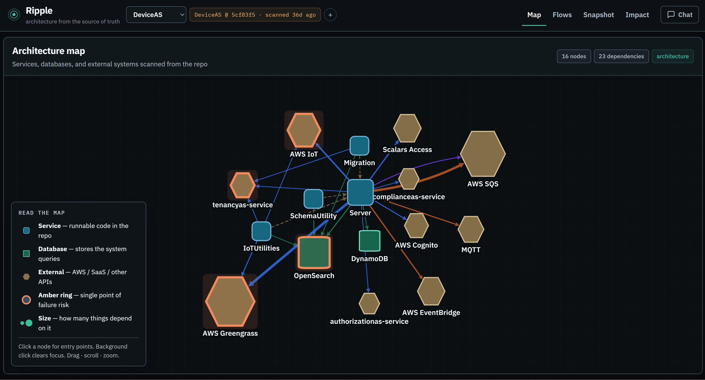

# Ripple



Ripple is a source-only request-flow and architecture explorer for C# and
ASP.NET Core repositories. It finds API routes and supported queue handlers,
follows local method calls, and maps every project to the databases, queues,
and external systems its code uses.

Ripple is designed for studying a repository without setting up its private
packages or running its build.

## What you need

- Node.js 20 or newer
- npm
- Python 3 with `venv`
- .NET 10 SDK
- Git

You do **not** need to:

- build the repository you want to study;
- run `dotnet restore` in that repository;
- authenticate with its private NuGet feeds; or
- install Ollama or provide an API key.

## Quick setup

### Linux, WSL, or macOS

1. Clone Ripple and enter its directory:

   ```bash
   git clone https://github.com/mahreenaisha/ripple.git
   cd ripple
   ```

2. Confirm the required tools are available:

   ```bash
   node --version
   python3 --version
   dotnet --version
   ```

   `dotnet --version` must report version 10 or newer. If Ripple runs in WSL,
   .NET must also be installed inside WSL; a Windows installation is separate.

3. Start Ripple:

   ```bash
   ./run-ripple.sh
   ```

   The script installs Ripple's missing frontend and backend dependencies,
   starts both services, and opens `http://localhost:4200`.

   Keep the terminal open while using Ripple. Press `Ctrl+C` to stop it.

### Start without opening a browser

```bash
./run-ripple.sh --no-browser
```

Then open `http://localhost:4200` yourself.

### Native Windows

Install Node.js, Python, Git, and the .NET 10 SDK in Windows. Then use two
PowerShell terminals.

Backend:

```powershell
cd backend
python -m venv venv
.\venv\Scripts\Activate.ps1
pip install -r requirements.txt
uvicorn main:app --reload --port 8000
```

Frontend:

```powershell
cd frontend
npm install
npm start
```

Open `http://localhost:4200`.

## Scan a repository

The repository must be cloned on the same machine or environment where Ripple's
backend runs. For example, a backend running in WSL should scan a WSL path such
as:

```text
/home/me/company/orders
```

In Ripple:

1. Click the `+` button beside the repository selector.
2. Enter the repository's absolute path.
3. Click **Check repository**.
4. Optionally change the display name.
5. Click **Scan repository**.

Ripple reads local `.cs` files and writes the generated snapshot inside the
Ripple project. It does not build, restore, or modify the scanned repository.

To refresh the results after the source changes, repeat these steps.

### Command-line scan

From the Ripple directory:

```bash
node scanner/scan-repo.js /absolute/path/to/csharp-repository
```

Choose the output name and location when needed:

```bash
node scanner/scan-repo.js /absolute/path/to/repository \
  --out snapshots/orders \
  --name Orders
```

Each snapshot contains:

```text
architecture-graph.json
request-flows.json
snapshot.json
```

## How analysis works

Ripple uses Roslyn syntax trees and available semantic symbols in an
`AdhocWorkspace`. It:

1. reads C# source files;
2. identifies supported ASP.NET controller and minimal API routes;
3. identifies supported C# queue handlers;
4. resolves local, overload-aware method calls when source evidence permits;
5. follows calls toward meaningful boundaries;
6. maps every non-test project from its project and package references, its
   configuration, and the client calls, registrations, and injections in its
   code; and
7. records files, lines, confidence, and evidence for every displayed step and
   Map connection.

Scanning is deterministic. An LLM is never used to discover routes, assemble
paths, rank paths, or assemble the architecture Map.

Every snapshot is marked as a **partial source-only analysis** because external
package symbols, generated code, MSBuild conditions, runtime dependency
injection, reflection, and dynamic behavior may be unavailable.

## Optional flow guide

The flow explorer works without an LLM. When no provider is configured, Ripple
uses deterministic evidence-only explanations.

For local Ollama, pull a small model:

```bash
ollama pull llama3.2:3b
```

Create `backend/.env`:

```dotenv
LLM_PROVIDER=ollama
OLLAMA_MODEL=llama3.2:3b
OLLAMA_BASE_URL=http://localhost:11434/v1
```

OpenRouter can be used instead:

```dotenv
LLM_PROVIDER=openrouter
OPENROUTER_API_KEY=your-key
OPENROUTER_MODEL=openrouter/free
```

Never commit `.env` or API keys.

## Project structure

```text
backend/                 FastAPI API and scan jobs
frontend/                Angular application
scanner/                 Roslyn request-flow and architecture analyzer
snapshots/<repo>/        Generated repository snapshots
knowledge/<repo>.yaml    Optional team knowledge
docs/                    Engineering and release notes
```

## Run checks

Run every scanner, backend, and frontend test plus the production build:

```bash
./test-all.sh
```

## Current scope and limitations

- Ripple supports C# and ASP.NET Core repositories only.
- Results come from static source analysis, not runtime telemetry.
- Missing or ambiguous behavior is shown as an inference limit instead of a
  guessed target.
- Generated and external code that is absent from the source clone cannot be
  analyzed.
- A detected path is evidence for repository study, not proof of production
  runtime behavior.

See `docs/CSHARP_ANALYZER.md` for analyzer details and
`docs/REQUEST_FLOW_RELEASE.md` for release criteria.
